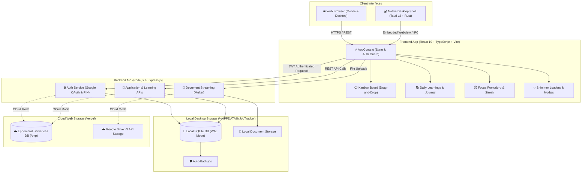

# 💼 Job Tracker – Modern Career Hub & Kanban System

[](https://nodejs.org/)
[](https://react.dev/)
[](https://www.typescriptlang.org/)
[-24c8db.svg)](https://tauri.app/)
[](LICENSE)
[]()

<div align="center">

[-0078D4?style=for-the-badge&logo=windows&logoColor=white)](docs/INSTALLATION.md#1-windows-desktop-app-installation)
[](docs/INSTALLATION.md#2-local-web-application-setup)
[](docs/INSTALLATION.md#3-cloud-deployment-vercel)
[](docs/INSTALLATION.md)

</div>

A high-performance, privacy-focused **Job Application Tracker & Career Management Hub** engineered with an interactive Kanban pipeline, daily learning logs, focus Pomodoro timer, streak gamification, activity heatmaps, Google Drive cloud storage, and native Windows desktop support via **Tauri v2**.

---

## 📑 Table of Contents

- [Installation Directions](#-installation-directions)
- [System Architecture](#-system-architecture)
- [Key Features](#-key-features)
- [Tech Stack](#-tech-stack)
- [Project Structure](#-project-structure)
- [Getting Started](#-getting-started)
  - [Prerequisites](#prerequisites)
  - [Web Application Setup](#web-application-setup)
  - [Environment Configuration](#environment-configuration)
- [Desktop Application (.exe)](#-desktop-application-exe)
  - [Quick Launch & Installation](#quick-launch--installation)
  - [How to Test the Desktop App](#how-to-test-the-desktop-app)
- [Google Services Setup](#-google-services-setup)
- [Documentation & Deep Dives](#-documentation--deep-dives)
- [License](#-license)

---

## 🚀 Installation Directions

Choose your target setup using the quick-access buttons below:

| Target Platform | Action Button | Description |
| :--- | :--- | :--- |
| **Windows Desktop (.exe)** | [👉 **Open Desktop Guide**](docs/INSTALLATION.md#1-windows-desktop-app-installation) | Step-by-step wizard setup (`Job Tracker_0.2.0_x64-setup.exe`) & 1-click launcher. |
| **Local Web Application** | [👉 **Open Web Setup Guide**](docs/INSTALLATION.md#2-local-web-application-setup) | Local Node.js + Express + React dev server at `http://localhost:3000`. |
| **Vercel Cloud Deploy** | [👉 **Open Vercel Guide**](docs/INSTALLATION.md#3-cloud-deployment-vercel) | Serverless cloud deployment with Google Drive document integration. |
| **Build from Source** | [👉 **Open Source Build Guide**](docs/INSTALLATION.md#4-building-the-desktop-app-from-source) | Developer guide for compiling Tauri binaries with Rust & MSVC C++. |

> 📖 **Full Installation Document**: For complete instructions, troubleshooting FAQs, and data backup steps, read **[docs/INSTALLATION.md](docs/INSTALLATION.md)**.

---

## 🏗️ System Architecture



> 📖 For detailed component interactions and data sequence diagrams, see [docs/ARCHITECTURE.md](docs/ARCHITECTURE.md).

---

## ✨ Key Features

### 📋 Interactive Kanban Pipeline
- **Multi-Stage Workflow**: Move cards across `Applied`, `Interviewing`, `Offer`, `Rejected`, and `Wishlist`.
- **Drag-and-Drop**: Fluid card transitions with responsive mobile touch support.
- **Comprehensive Job Details**: Track company, job role, salary/compensation, location, deadlines, and direct portal credentials.
- **Document Attachments**: Link tailored resumes and cover letters directly to job records.
- **Keyboard Filters**: Real-time search across company names, roles, tags, and status.

### 📚 Daily Learnings & Focus Gamification
- **Study Log Journal**: Capture technical topics, aptitude prep, notes, duration, and reference links.
- **Focus Pomodoro Timer**: Built-in interval timer with automatic study session logging.
- **Streak & XP Progress**: Maintain daily application and study streaks; level up from *Novice* to *Grandmaster*.
- **Activity Heatmaps**: GitHub-style dual-track calendar visualizer comparing job applications submitted vs. study sessions completed.

### 🔒 Privacy & Multi-User Isolation
- **Dual Authentication**: Sign in via **Google OAuth 2.0** or passwordless **Workspace PIN**.
- **Zero-Fetch Logged-Out Guard**: Unauthenticated views display zero private records and execute no background requests.
- **Strict SQL Parameterization**: Every database query is strictly isolated per `user_id`.

### 💻 Native Desktop Application (Tauri v2)
- **Ultra-Lightweight**: Compact ~3.5 MB installer compared to 150MB+ typical Electron distributions.
- **Local Data Privacy**: Stores all SQLite data (`tracker.db`) and uploaded documents locally in `%APPDATA%\JobTracker\`.
- **System Tray Integration**: Minimize-to-tray on window close, quick access menus, and background persistence.

---

## 🛠️ Tech Stack

| Layer | Technologies |
| :--- | :--- |
| **Frontend** | React 19, TypeScript, Vite, Tailwind CSS, Lucide Icons |
| **Backend** | Node.js (v20+), Express.js (v5), Multer streaming |
| **Database** | SQLite with Write-Ahead Logging (`WAL`), `node:sqlite` |
| **Desktop Shell** | Tauri v2, Rust 2021, Microsoft Edge WebView2 |
| **Authentication** | JWT (`jsonwebtoken`), Google Identity Services (GIS), bcrypt |
| **Cloud Storage** | Google Drive API v3 (Google Service Account) |
| **Deployment** | Vercel Serverless (`@vercel/node`) & Windows NSIS Setup Installer |

---

## 📂 Project Structure

```plaintext
kanban_board/
├── api/                           # Vercel serverless entry point
├── board_website/
│   ├── backend/                   # Modular Express.js REST API
│   │   ├── src/config/            # Environment & storage resolution
│   │   ├── src/controllers/       # Application, learning & auth logic
│   │   ├── src/database/          # SQLite schema, migrations & seeders
│   │   ├── src/routes/            # Express route declarations
│   │   └── server.js              # Local server bootstrap
│   └── frontend/                  # React 19 + TypeScript + Vite SPA
│       ├── src/components/        # Kanban, Learnings, Modals & Skeletons
│       ├── src/context/           # AppContext state & auto-sync logic
│       └── vite.config.ts         # Vite build configuration
├── desktop_app/                   # Tauri v2 Desktop Application
│   ├── src-tauri/                 # Rust native shell, tray & IPC handlers
│   │   └── target/release/        # Compiled standalone app.exe & installers
│   └── start-desktop.bat          # Desktop background engine launcher
├── docs/                          # Detailed architecture & desktop guides
│   ├── ARCHITECTURE.md            # In-depth system diagrams & schema
│   └── DESKTOP_GUIDE.md           # Desktop build, install & test guide
├── start-desktop.bat              # 1-Click root launcher for Windows
├── package.json                   # Root package & orchestration scripts
├── vercel.json                    # Vercel routing configuration
└── README.md                      # Primary project documentation
```

---

## 🚀 Getting Started

### Prerequisites
- [Node.js](https://nodejs.org/) v20.0.0 or higher
- [Rust & Cargo](https://rustup.rs/) v1.78+ *(only if building the desktop app from source)*
- Visual Studio C++ Build Tools *(only if compiling desktop binaries)*

### Web Application Setup

1. **Clone the repository**:
   ```bash
   git clone https://github.com/varunchandra10/job_kanban_board.git
   cd job_kanban_board
   ```

2. **Install dependencies**:
   ```bash
   npm install
   cd board_website/frontend && npm install
   cd ../backend && npm install
   ```

3. **Configure environment variables**:
   ```bash
   cp .env.example .env
   ```

4. **Start local development server**:
   ```bash
   # From project root
   npm start
   ```
   Open your browser at `http://localhost:3000`.

---

## 💻 Desktop Application (.exe)

Job Tracker can run as a 100% offline, local-first Windows desktop application.

### Quick Launch & Installation

| Option | Location Link | How to Use |
| :--- | :--- | :--- |
| **🚀 1-Click Auto Launcher** | [`start-desktop.bat`](start-desktop.bat) | Double-click to start local engine on port 3000 and launch the desktop app window. |
| **📦 Windows Setup Installer** | [`Job Tracker_0.2.0_x64-setup.exe`](desktop_app/src-tauri/target/release/bundle/nsis/Job%20Tracker_0.2.0_x64-setup.exe) | Double-click to install into `%LOCALAPPDATA%\Programs\Job Tracker` with Desktop & Start Menu shortcuts. |
| **⚡ Standalone Portable Binary** | [`app.exe`](desktop_app/src-tauri/target/release/app.exe) | Native binary; runs directly without installation. |

### How to Test the Desktop App

1. Double-click [`start-desktop.bat`](start-desktop.bat) in the project root.
2. The launcher automatically ensures the local database engine is running in the background.
3. Test key features:
   - **Kanban Board**: Drag and drop cards between hiring stages.
   - **Form Verification**: Open the Add Application modal to test responsive layouts and date inputs.
   - **Focus Timer**: Start a Pomodoro interval and observe streak increments.
   - **System Tray**: Click the close button <kbd>×</kbd> — the app safely minimizes to the Windows System Tray and restores upon clicking the tray icon.
   - **Native Menu**: Select `File` → `Open Data Folder` to inspect your local database in `%APPDATA%\JobTracker\`.

> 📘 For advanced packaging, DevTools, and troubleshooting, refer to [docs/DESKTOP_GUIDE.md](docs/DESKTOP_GUIDE.md).

---

## ☁️ Google Services Setup

To enable Google OAuth and Google Drive resume storage:

1. **Google Cloud Console**: Enable **Google Drive API** and configure the **OAuth Consent Screen**.
2. **OAuth Credentials**: Create a Web Application Client ID and add `http://localhost:3000` to Authorized JavaScript origins.
3. **Service Account**: Create a Service Account, generate a JSON key, and save it as `google-service-account.json`.
4. **Drive Folder**: Create a Google Drive folder, share it with the Service Account email as **Editor**, and add the folder ID to `.env`:
   ```env
   GOOGLE_CLIENT_ID=your_client_id.apps.googleusercontent.com
   GOOGLE_CLIENT_SECRET=your_client_secret
   GOOGLE_DRIVE_FOLDER_ID=your_drive_folder_id
   GOOGLE_SERVICE_ACCOUNT_KEY_PATH=./google-service-account.json
   ```

---

## 📚 Documentation & Deep Dives

- **[docs/INSTALLATION.md](docs/INSTALLATION.md)** – Comprehensive step-by-step installation directions for Desktop (.exe), Local Web dev server, Vercel cloud, and build-from-source.
- **[docs/ARCHITECTURE.md](docs/ARCHITECTURE.md)** – System architecture diagrams, authentication sequence flows, ER database schema, and security models.
- **[docs/DESKTOP_GUIDE.md](docs/DESKTOP_GUIDE.md)** – Native desktop manual covering offline mode, system tray integration, developer tools, and Tauri packaging.

---

## 📄 License

This project is licensed under the [MIT License](LICENSE).
