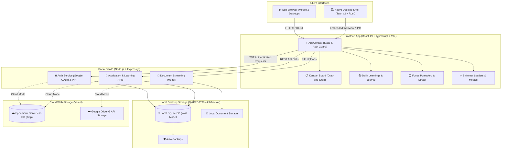

# 💼 Job Tracker – Modern Career Hub & Kanban System

[](https://nodejs.org/)
[](https://react.dev/)
[](https://www.typescriptlang.org/)
[-24c8db.svg)](https://tauri.app/)
[](LICENSE)
[]()

A high-performance, privacy-focused **Job Application Tracker & Career Management Hub** engineered with an interactive Kanban pipeline, daily learning logs, focus Pomodoro timer, streak gamification, activity heatmaps, and native Windows desktop support.

---

<div align="center">

## 📥 Get Job Tracker for Windows

[-Job--Tracker--Setup.msi-0078D4?style=for-the-badge&logo=windows&logoColor=white)](https://github.com/varunchandra10/job_kanban_board/raw/refs/heads/main/installer/Job-Tracker-Setup.msi)
[-Job--Tracker--Portable.exe-2EA44F?style=for-the-badge&logo=windows&logoColor=white)](https://github.com/varunchandra10/job_kanban_board/raw/refs/heads/main/installer/Job-Tracker-Portable.exe)
[-Job--Tracker--Setup.exe-6B7280?style=for-the-badge&logo=windows&logoColor=white)](https://github.com/varunchandra10/job_kanban_board/raw/refs/heads/main/installer/Job-Tracker-Setup.exe)

[](https://github.com/varunchandra10/job_kanban_board/releases)
[](docs/INSTALLATION.md)

</div>

---

## ⚡ Quick Start: How to Install & Use (1 Minute)

No coding or setup required. Choose the easiest option for you:

* **Option A — Recommended Windows Installer (.msi)**:
  👉 Download **[Job-Tracker-Setup.msi](https://github.com/varunchandra10/job_kanban_board/raw/refs/heads/main/installer/Job-Tracker-Setup.msi)** & double-click to install. *(Native Windows MSI installer — never gets temp extraction errors!)*
* **Option B — Portable Edition (.exe)**:
  👉 Download **[Job-Tracker-Portable.exe](https://github.com/varunchandra10/job_kanban_board/raw/refs/heads/main/installer/Job-Tracker-Portable.exe)** & double-click to run immediately without any installation!
* **Option C — Standard Setup (.exe)**:
  👉 Download **[Job-Tracker-Setup.exe](https://github.com/varunchandra10/job_kanban_board/raw/refs/heads/main/installer/Job-Tracker-Setup.exe)**.

> **💡 Fix for "NSIS Error: Error writing temporary file"**:
> If Windows blocks extracting temporary files (common when running inside OneDrive or without write permissions):
> 1. Use the **[.msi Installer](https://github.com/varunchandra10/job_kanban_board/raw/refs/heads/main/installer/Job-Tracker-Setup.msi)** or **[Portable .exe](https://github.com/varunchandra10/job_kanban_board/raw/refs/heads/main/installer/Job-Tracker-Portable.exe)** instead.
> 2. Or move `Job-Tracker-Setup.exe` to your regular **Downloads** folder (outside OneDrive) and right-click &rarr; **Run as administrator**.

> **Note on Windows SmartScreen**: If Windows displays *"Windows protected your PC"*, click **More info** &rarr; **Run anyway**. *(Standard for independent apps without corporate certificates).*

3. **Open Job Tracker**:
   The installer automatically creates a **Desktop Shortcut** and **Start Menu entry**. Double-click the **Job Tracker** icon and start tracking your career applications!

> 🔒 **100% Privacy Guarantee**: All your applications, compensation data, notes, and uploaded resumes are stored privately on your computer in a local SQLite database (`%APPDATA%\JobTracker`). No cloud accounts or subscriptions required.

---

## ✨ Features

### 📋 Interactive Kanban Pipeline
- **5-Stage Hiring Workflow**: Organize applications across `Applied`, `Interviewing`, `Offer`, `Rejected`, and `Wishlist`.
- **Drag-and-Drop Cards**: Fluid transitions between hiring stages.
- **Detailed Tracking**: Record company, role, salary, location, deadlines, and application links.
- **Resume & Document Attachments**: Keep your tailored resumes and cover letters organized per role.
- **Instant Search & Filters**: Search across company names, roles, and tags instantly.

### 📚 Daily Learnings & Focus Gamification
- **Study Log Journal**: Capture daily technical prep, aptitude notes, and reference links.
- **Focus Pomodoro Timer**: Built-in study timer with automated session tracking.
- **Streak & XP Progress**: Maintain daily momentum and level up from *Novice* to *Grandmaster*.
- **Activity Heatmap**: GitHub-style visual calendar showing your job applications and study consistency over time.

### 💻 Native Desktop Experience
- **Ultra-Lightweight**: Only ~3.5 MB installer (unlike 150MB+ Electron apps).
- **System Tray Integration**: Minimizes cleanly to your Windows System Tray (near the clock).
- **Offline-First**: Fully functional without an internet connection.

---

## 🏗️ System Architecture



---

## 🛠️ Tech Stack

| Layer | Technologies |
| :--- | :--- |
| **Desktop Shell** | Tauri v2, Rust 2021, Microsoft Edge WebView2 |
| **Frontend UI** | React 19, TypeScript, Vite, Tailwind CSS, Lucide Icons |
| **Backend Engine** | Node.js (v20+), Express.js (v5), Multer file streaming |
| **Database** | SQLite with Write-Ahead Logging (`WAL`), `node:sqlite` |
| **Authentication** | JWT (`jsonwebtoken`), Google Identity Services (GIS), bcrypt |
| **Cloud Storage** | Google Drive API v3 (for cloud web deployment) |

---

## 💻 Developer Setup (Running from Source)

If you are a developer and want to run the project locally or contribute:

### Prerequisites
- [Node.js](https://nodejs.org/) v20.0.0 or higher
- Git

### 3-Step Local Setup

1. **Clone the repository**:
   ```bash
   git clone https://github.com/varunchandra10/job_kanban_board.git
   cd job_kanban_board
   ```

2. **Install dependencies**:
   ```bash
   npm install
   cd board_website/frontend && npm install
   cd ../backend && npm install
   cd ../..
   ```

3. **Start the local server**:
   ```bash
   npm start
   ```
   Open your browser and navigate to **`http://localhost:3000`**.

---

## 📚 Documentation

For in-depth technical details, check out our documentation guides:

- **[Installation Manual](docs/INSTALLATION.md)** – Comprehensive installation instructions for Windows, local web server, and Vercel cloud deployment.
- **[System Architecture](docs/ARCHITECTURE.md)** – Deep dive into system topology, authentication flows, ER database schema, and security guarantees.
- **[Desktop Guide](docs/DESKTOP_GUIDE.md)** – Advanced desktop options, system tray controls, local database locations, and packaging instructions.

---

## 📄 License

This project is open-source and licensed under the [MIT License](LICENSE).
