# Job Kanban Board: Comprehensive Remediation & Security Hardening Plan

**Document Version:** 1.0.0  
**Target Applications:** `board_website` (Backend & Frontend), `desktop_app` (Tauri Desktop Client)  
**Classification:** Engineering Roadmap & Security Architecture  

---

## 1. Executive Summary & Objectives

Following an exhaustive audit of the Job Tracker project across security, multi-tenancy isolation, system architecture, offline data resilience, and desktop client compatibility, this document details the step-by-step engineering plan to resolve all identified vulnerabilities, architectural bottlenecks, and UX bugs.

### Primary Objectives:
1. **Eliminate Critical Security Vulnerabilities:**
   - Patch Local File Inclusion (LFI) and path traversal in the file storage service.
   - Prevent multi-tenant database and document leakage in backup exports.
   - Enforce cryptographic validation on Google OAuth tokens.
   - Seal unauthenticated document viewing endpoints.
   - Prevent IDOR and mass assignment on application ownership.
2. **Harden Data & Account Security:**
   - Implement symmetric AES-256-GCM encryption for stored job portal passwords.
   - Introduce rate limiting and attempt counters for password reset codes.
3. **Enhance System Stability & Architecture:**
   - Remove destructive database file unlinking in SQLite connection fallbacks.
   - Transition from RAM-heavy Multer memory buffering to disk streaming.
4. **Resilience & Desktop Client Polish:**
   - Implement an offline mutation queue in the React frontend to prevent data loss.
   - Sanitize shell executions in Tauri commands and support cross-platform file operations.

---

## 2. Phased Implementation Timeline

```mermaid
flowchart TD
    P1["Phase 1: Critical Security Fixes (P0) [COMPLETED]<br/>• Storage Path Traversal Fix<br/>• Multi-tenant Backup Isolation<br/>• Google ID Token Cryptographic Verification<br/>• Document Auth Guard<br/>• Application user_id Mass Assignment"]
    P2["Phase 2: Credential & Auth Protection (P1) [COMPLETED]<br/>• AES-256 Portal Password Encryption<br/>• Password Reset Rate Limiting & Attempt Lockout"]
    P3["Phase 3: System Architecture & Stability (P2) [COMPLETED]<br/>• Database Unlink Safeguard<br/>• Multer Disk Streaming & Memory Optimization<br/>• Vercel/Turso Deployment Assertion"]
    P4["Phase 4: Client Offline Resilience (P2) [COMPLETED]<br/>• Offline Mutation Queue<br/>• Conflict-Safe Background Sync"]
    P5["Phase 5: Desktop App Hardening (P3) [COMPLETED]<br/>• Safe Command Spawning<br/>• Cross-Platform File Manager Support<br/>• Dynamic Version Updater"]
    P6["Phase 6: Critical Security & Remote Execution Hardening (P0)<br/>• Google OAuth Account Takeover Fix<br/>• Server Command Injection & GUI Spawning Fix<br/>• Login Rate Limiting & Enumeration Defense"]
    P7["Phase 7: Offline Queue Resilience & State Synchronization (P1)<br/>• Poison-Pill Dead-Lettering (4xx Drop)<br/>• User-Scoped Offline Storage<br/>• Debounced Mutex Sync"]
    P8["Phase 8: Data Integrity, Cleanup & Cryptographic Architecture (P2)<br/>• Application Deletion Cascading Cleanup<br/>• Transactional Kanban Reordering<br/>• Scoped File Tokens & Security Headers"]

    P1 --> P2 --> P3 --> P4 --> P5 --> P6 --> P7 --> P8
```

---

## 3. Detailed Engineering Steps by Phase

### Phase 1: Critical Security Fixes (Immediate Priority - P0)

#### Task 1.1: Fix Arbitrary File Read & Deletion in `storageService.js` [COMPLETED]
* **Files Affected:** [`board_website/backend/src/services/storageService.js`](file:///c:/Users/kvcsu_ht23nk8/OneDrive/Desktop/Job_stuff/kanban_board/board_website/backend/src/services/storageService.js#L30-L65), [`board_website/backend/src/services/googleDriveStorageService.js`](file:///c:/Users/kvcsu_ht23nk8/OneDrive/Desktop/Job_stuff/kanban_board/board_website/backend/src/services/googleDriveStorageService.js#L61-L71)
* **Problem:** Path traversal checking (`path.relative(this.rootDir, p)`) only executed when `!fs.existsSync(p)`. If an absolute path to any existing file on disk was provided, it bypassed checks completely.
* **Status:** Resolved & Verified.
  1. `LocalStorageService` now enforces `isPathInside` and `isSystemPath` checks across all allowed directories (`uploadDir`, `documents`, custom user storage dir).
  2. Absolute and relative paths outside allowed directories return `null` and generate security alert logs.
  3. `deleteFile` strictly validates allowed directory boundaries and refuses deletion of system/database/code files (`.db`, `.env`, `.sqlite`, `.js`, etc.).
* **Testing:** Verified via automated sandboxing test covering `win.ini`, `/etc/passwd`, relative traversal `../../../../.env`, null bytes, and legitimate file creation/deletion.

#### Task 1.2: Isolate User Backups in `backupController.js` [COMPLETED]
* **Files Affected:** [`board_website/backend/src/controllers/backupController.js`](file:///c:/Users/kvcsu_ht23nk8/OneDrive/Desktop/Job_stuff/kanban_board/board_website/backend/src/controllers/backupController.js#L18-L79), [`board_website/frontend/src/components/profile/CareerProfile.tsx`](file:///c:/Users/kvcsu_ht23nk8/OneDrive/Desktop/Job_stuff/kanban_board/board_website/frontend/src/components/profile/CareerProfile.tsx#L491-L501)
* **Problem:** `exportZip` archives the physical `config.dbPath` file and the entire `config.uploadDir` folder, exposing all users' data to any caller. `backupDatabase` lacks authentication.
* **Status:** Resolved & Verified.
  1. `exportZip` rewritten to query strictly user-isolated tables matching `WHERE user_id = req.user.id` (applications, profile, versions, activity, settings).
  2. Creates structured `data/job-tracker-data.json`, `data/applications.csv`, user documents from `document_files` and user-linked local files, plus a clear manifest `README.txt`.
  3. Physical `tracker.db` and full `uploadDir` directory bundling completely removed from ZIP export.
  4. `backupDatabase` now enforces authentication and restricts physical snapshots to local desktop mode (`config.isDesktop`).
  5. Frontend `CareerProfile.tsx` updated to attach the user's `?token=` parameter so authenticated ZIP downloads trigger smoothly.
* **Testing:** Verified multi-tenant isolation with concurrent mock users. Extracted archive confirms presence of User A data and 0% leakage of User B records or files.

#### Task 1.3: Cryptographically Verify Google ID Tokens [COMPLETED]
* **Files Affected:** [`board_website/backend/src/controllers/authController.js`](file:///c:/Users/kvcsu_ht23nk8/OneDrive/Desktop/Job_stuff/kanban_board/board_website/backend/src/controllers/authController.js#L151-L245), [`board_website/frontend/src/components/ui/AuthModal.tsx`](file:///c:/Users/kvcsu_ht23nk8/OneDrive/Desktop/Job_stuff/kanban_board/board_website/frontend/src/components/ui/AuthModal.tsx#L185-L195), [`board_website/frontend/src/services/api.ts`](file:///c:/Users/kvcsu_ht23nk8/OneDrive/Desktop/Job_stuff/kanban_board/board_website/frontend/src/services/api.ts#L218-L225)
* **Problem:** `googleAuth` blindly parsed unverified JWT payloads and allowed unauthenticated callers to pass arbitrary `{ profile: { email } }` payloads.
* **Status:** Resolved & Verified.
  1. `googleAuth` now enforces cryptographic validation using official `google-auth-library` (`OAuth2Client.verifyIdToken()`).
  2. For web popup access tokens, validates audience with Google's `oauth2.googleapis.com/tokeninfo` and fetches verified email from Google UserInfo.
  3. Acceptance of arbitrary unverified `req.body.profile` is completely eliminated (rejected with HTTP 400).
  4. Frontend updated to transmit verified Google credentials/tokens cleanly.
* **Testing:** Automated test suite confirms rejection of raw profile spoofing (`400`), forged ID tokens (`401`), and fake access tokens (`401`). Frontend build passed cleanly.

#### Task 1.4: Enforce Authentication on Document Endpoints [COMPLETED]
* **Files Affected:** [`board_website/backend/src/middleware/auth.js`](file:///c:/Users/kvcsu_ht23nk8/OneDrive/Desktop/Job_stuff/kanban_board/board_website/backend/src/middleware/auth.js#L37-L46), [`board_website/backend/src/controllers/documentsController.js`](file:///c:/Users/kvcsu_ht23nk8/OneDrive/Desktop/Job_stuff/kanban_board/board_website/backend/src/controllers/documentsController.js#L286-L550)
* **Problem:** `/api/file-content` and `/api/document-content` were included in `readOnlyPaths`, bypassing authentication.
* **Status:** Resolved & Verified.
  1. Removed all document endpoints from `readOnlyPaths` in `auth.js`. Unauthenticated requests immediately receive `401 Unauthorized`.
  2. In `getFileContent` and `getFileInfo`, enforced strict user authentication and ownership check (`doc.user_id === callerId`).
  3. Added cross-user file ownership verification for local disk paths referenced in applications.
  4. In `deleteDocument`, scoped document deletion strictly to the requesting user's records (`DELETE ... WHERE user_id = ?`).
* **Testing:** Verified via automated test suite: unauthenticated requests blocked (`401`), cross-user access attempts blocked (`403 Forbidden`), cross-user deletion attempts prevented, legitimate document serving succeeded (`200`).

#### Task 1.5: Fix IDOR / Mass-Assignment in `patch()` [COMPLETED]
* **Files Affected:** [`board_website/backend/src/database/db.js`](file:///c:/Users/kvcsu_ht23nk8/OneDrive/Desktop/Job_stuff/kanban_board/board_website/backend/src/database/db.js#L270-L310), [`board_website/backend/src/controllers/applicationsController.js`](file:///c:/Users/kvcsu_ht23nk8/OneDrive/Desktop/Job_stuff/kanban_board/board_website/backend/src/controllers/applicationsController.js#L65-L115)
* **Problem:** `COLS.applications` contains `user_id`. Calling `patch()` with a custom `user_id` allows changing application ownership.
* **Status:** Resolved & Verified.
  1. Removed `user_id` from `COLS.applications`, `COLS.resume_profile`, and `COLS.resume_versions`.
  2. Implemented `IMMUTABLE_FIELDS` in `patch()`, stripping `user_id`, `id`, `created_at`, `updated_at` before column filtering.
  3. Sanitized `createApplication` and `updateApplication` payloads in `applicationsController.js` to prevent user ID assignment or hijacking.
  4. Enforced strict ownership isolation: updates and moves are scoped with `where id=? and user_id=?`.
* **Testing:** Verified via automated IDOR test suite: user_id injection during creation blocked, user_id modification via PATCH blocked, direct `patch()` immutability verified, cross-user updates prohibited.

---

### Phase 2: Credential & Account Protection (P1)

#### Task 2.1: Symmetric Encryption for Portal Passwords [COMPLETED]
* **Files Affected:** [`board_website/backend/src/services/cryptoService.js`](file:///c:/Users/kvcsu_ht23nk8/OneDrive/Desktop/Job_stuff/kanban_board/board_website/backend/src/services/cryptoService.js), [`board_website/backend/src/database/db.js`](file:///c:/Users/kvcsu_ht23nk8/OneDrive/Desktop/Job_stuff/kanban_board/board_website/backend/src/database/db.js#L270-L385), [`board_website/backend/src/controllers/applicationsController.js`](file:///c:/Users/kvcsu_ht23nk8/OneDrive/Desktop/Job_stuff/kanban_board/board_website/backend/src/controllers/applicationsController.js#L65-L100), [`board_website/backend/src/controllers/backupController.js`](file:///c:/Users/kvcsu_ht23nk8/OneDrive/Desktop/Job_stuff/kanban_board/board_website/backend/src/controllers/backupController.js#L54-L63)
* **Problem:** Portal credentials (`portal_pass`) were saved in clear text in SQLite, allowing anyone with database read access to view external corporate portal passwords.
* **Status:** Resolved & Verified.
  1. Created [`cryptoService.js`](file:///c:/Users/kvcsu_ht23nk8/OneDrive/Desktop/Job_stuff/kanban_board/board_website/backend/src/services/cryptoService.js) implementing AES-256-GCM authenticated encryption with 12-byte random IVs and 16-byte authentication tags (ciphertext format: `enc:v1:<iv>:<tag>:<ciphertext>`).
  2. Derived encryption key from dedicated `PORTAL_CREDENTIALS_SECRET` or fallback `JWT_SECRET` with cryptographic domain separation salt.
  3. Modified `patch()` in `db.js` and `createApplication` in `applicationsController.js` to automatically encrypt passwords before writing to SQLite.
  4. Modified `getState()` and user `exportZip` in `backupController.js` to decrypt `portal_pass` before returning to authenticated owner.
  5. Implemented `migratePlaintextCredentials()` to automatically and idempotently encrypt legacy plaintext rows on startup.
* **Testing:** Automated test suite (`test_portal_password_crypto.js`) verified primitive encryption/decryption, tamper detection, SQLite ciphertext storage, `getState()` owner decryption, `patch()` update encryption, and automatic legacy plaintext migration.

#### Task 2.2: Rate Limiting & Attempt Lockout for Password Resets [COMPLETED]
* **Files Affected:** [`board_website/backend/src/controllers/authController.js`](file:///c:/Users/kvcsu_ht23nk8/OneDrive/Desktop/Job_stuff/kanban_board/board_website/backend/src/controllers/authController.js#L605-L730), [`board_website/backend/src/routes/auth.js`](file:///c:/Users/kvcsu_ht23nk8/OneDrive/Desktop/Job_stuff/kanban_board/board_website/backend/src/routes/auth.js#L9-L10), [`board_website/backend/src/middleware/rateLimiter.js`](file:///c:/Users/kvcsu_ht23nk8/OneDrive/Desktop/Job_stuff/kanban_board/board_website/backend/src/middleware/rateLimiter.js#L38-L50), [`board_website/backend/src/database/migrator.js`](file:///c:/Users/kvcsu_ht23nk8/OneDrive/Desktop/Job_stuff/kanban_board/board_website/backend/src/database/migrator.js#L11-L35)
* **Problem:** 6-digit password reset verification codes lacked attempt limits and rate limiting, leaving them susceptible to online brute-force guessing and endpoint abuse.
* **Status:** Resolved & Verified.
  1. Updated `password_resets` schema in `migrator.js` and `authController.js` to track `attempts INTEGER DEFAULT 0`.
  2. In `resetPassword`, tracked failed verification code attempts against the specific reset record, providing clear warning notices (e.g. "4 attempts remaining before lockout").
  3. On the 5th incorrect attempt, the reset token is permanently deleted and caller receives `429 Too Many Requests: Maximum verification attempts exceeded. Reset code has been locked and invalidated. Please request a new code.`
  4. Installed `express-rate-limit` and configured `passwordResetLimiter` (15-minute window, max 5 requests per IP) across both `/api/auth/forgot-password` and `/api/auth/reset-password` endpoints.
* **Testing:** Automated test suite (`test_password_reset_lockout.js`) confirmed schema migration, progressive attempt counter increments (attempts 1-4), immediate record deletion and `429` rejection on attempt 5, permanent lockout on subsequent attempts, password update on valid submission, and IP rate limiting (5 allowed, 6th blocked with `429`).

---

### Phase 3: System Architecture & Stability (P2)

#### Task 3.1: Remove Destructive Database Deletion Fallback [COMPLETED]
* **Files Affected:** [`board_website/backend/src/database/db.js`](file:///c:/Users/kvcsu_ht23nk8/OneDrive/Desktop/Job_stuff/kanban_board/board_website/backend/src/database/db.js#L123-L165)
* **Problem:** If SQLite threw an error on opening (e.g. transient file locking by another process or anti-virus), the catch block called `fs.unlinkSync(config.dbPath)`, destroying all user application data and documents.
* **Status:** Resolved & Verified.
  1. Completely removed all calls to `fs.unlinkSync(config.dbPath)` and WAL/SHM file unlinking from `db.js`.
  2. Implemented `openDatabaseWithRetry()` with exponential backoff (250ms, 500ms, 1000ms) to safely recover from transient file locks.
  3. On persistent failure, safely aborts process startup with a critical diagnostic error explaining that the database file has been preserved to protect data.
* **Testing:** Automated test suite (`test_safe_db_open.js`) verified retry recovery on transient lock contention (`SQLITE_BUSY`), verified that database files are 100% preserved and intact after persistent lock failures, and verified normal query execution on startup.

#### Task 3.2: Multer Memory Storage Optimization [COMPLETED]
* **Files Affected:** [`board_website/backend/src/middleware/upload.js`](file:///c:/Users/kvcsu_ht23nk8/OneDrive/Desktop/Job_stuff/kanban_board/board_website/backend/src/middleware/upload.js), [`board_website/backend/src/controllers/documentsController.js`](file:///c:/Users/kvcsu_ht23nk8/OneDrive/Desktop/Job_stuff/kanban_board/board_website/backend/src/controllers/documentsController.js#L60-L295), [`board_website/backend/src/services/googleDriveStorageService.js`](file:///c:/Users/kvcsu_ht23nk8/OneDrive/Desktop/Job_stuff/kanban_board/board_website/backend/src/services/googleDriveStorageService.js#L303-L355)
* **Problem:** Multer was configured with `memoryStorage()`, causing large file uploads (up to 50MB) to buffer entirely on the V8 heap as contiguous Buffers, risking Out-Of-Memory (OOM) crashes in memory-constrained serverless/container environments.
* **Status:** Resolved & Verified.
  1. Built custom `HybridStorageEngine` for Multer: files $\le$ 2MB are kept in memory as Buffers, while files $>$ 2MB immediately spill over and stream chunks directly to temporary scratch files in `os.tmpdir()/job-tracker-uploads`, dropping memory chunk references immediately.
  2. Updated `googleDriveStorageService.js:saveFile` to support streaming directly from `filePath` via `fs.createReadStream()` instead of buffering into heap.
  3. Updated `documentsController.js:uploadDocument` to handle both buffer and disk streams, and wrapped processing in a `finally` block to guarantee temporary upload scratch files are deleted from disk regardless of success or failure.
* **Testing:** Automated test suite (`test_multer_hybrid_storage.js`) verified in-memory buffering for small files, spillover streaming to disk for large files, controller base64/disk processing, and guaranteed `finally` cleanup of scratch files on both success and error paths.

#### Task 3.3: Production Environment Assertions [COMPLETED]
* **Files Affected:** [`board_website/backend/src/database/db.js`](file:///c:/Users/kvcsu_ht23nk8/OneDrive/Desktop/Job_stuff/kanban_board/board_website/backend/src/database/db.js#L53-L65), [`board_website/backend/src/config/index.js`](file:///c:/Users/kvcsu_ht23nk8/OneDrive/Desktop/Job_stuff/kanban_board/board_website/backend/src/config/index.js#L110-L130), [`board_website/backend/src/app.js`](file:///c:/Users/kvcsu_ht23nk8/OneDrive/Desktop/Job_stuff/kanban_board/board_website/backend/src/app.js#L28-L55)
* **Problem:** In serverless deployments (such as Vercel), deploying without `TURSO_DATABASE_URL` silently writes SQLite to ephemeral `/tmp/tracker.db`, which is wiped every time a serverless function instance spins down or redeploys, causing data loss without obvious error messages.
* **Status:** Resolved & Verified.
  1. Updated `config/index.js` and `database/db.js` to emit clear, high-visibility diagnostic warnings during startup whenever running in Vercel (`process.env.VERCEL`) without `TURSO_DATABASE_URL`.
  2. Enhanced `/api/health` and `/health` endpoints to expose structured `persistence` diagnostic metadata (`isPermanent`, `isEphemeral`, `type`, `storageLocation`, and detailed warnings), allowing frontend dashboards and monitoring health checks to catch ephemeral deployments proactively.
* **Testing:** Automated test suite (`test_env_assertions_health.js`) verified permanent local disk verification, ephemeral Vercel deployment assertion & diagnostic warning output, and Turso cloud database permanent persistence assertion.

---

### Phase 4: Client Offline Resilience (P2)

#### Task 4.1: Frontend Offline Mutation Queue [COMPLETED]
* **Files Affected:** [`board_website/frontend/src/services/offlineSync.ts`](file:///c:/Users/kvcsu_ht23nk8/OneDrive/Desktop/Job_stuff/kanban_board/board_website/frontend/src/services/offlineSync.ts), [`board_website/frontend/src/context/AppContext.tsx`](file:///c:/Users/kvcsu_ht23nk8/OneDrive/Desktop/Job_stuff/kanban_board/board_website/frontend/src/context/AppContext.tsx#L365-L770)
* **Problem:** When users operated offline or experienced network latency/dropouts, client mutations (adding applications, moving stages, updating fields, logging learnings) failed silently without persistence. On tab focus or refresh, `refreshState()` overwrote the local optimistic UI with stale server data, permanently losing offline changes.
* **Status:** Resolved & Verified.
  1. Created [`offlineSync.ts`](file:///c:/Users/kvcsu_ht23nk8/OneDrive/Desktop/Job_stuff/kanban_board/board_website/frontend/src/services/offlineSync.ts) managing an action queue (`job_tracker_mutation_queue`) in `localStorage` with FIFO ordering, retry counters, and dynamic client-to-server ID mapping (`job_tracker_id_map`).
  2. Updated all CRUD methods in `AppContext.tsx` (`addApplication`, `updateApplication`, `deleteApplication`, `moveApplication`, `addLearning`, `updateLearning`, `deleteLearning`) to catch network drops, maintain optimistic state, and enqueue pending mutations.
  3. Integrated automatic flush listeners for `online`, `visibilitychange`, and `focus` events. Mutations are synced sequentially, temporary client IDs (`Date.now()`) are remapped to permanent SQLite IDs, and `refreshState()` is triggered only after synchronization completes.
* **Testing:** Automated test suite (`test_offline_mutation_queue.js`) verified FIFO queuing, server ID remapping across dependent mutations, network-drop queue preservation, and frontend production build (`npm run build`) succeeded with 0 errors.

---

### Phase 5: Desktop App (Tauri) Hardening (P3)

#### Task 5.1: Safe Command Execution & Parameter Sanitization [COMPLETED]
* **Files Affected:** [`desktop_app/src-tauri/src/commands.rs`](file:///c:/Users/kvcsu_ht23nk8/OneDrive/Desktop/Job_stuff/kanban_board/desktop_app/src-tauri/src/commands.rs#L269-L285)
* **Problem:** In Windows desktop mode, `open_file` spawned `cmd /c start "" <path>`, making file opening vulnerable to shell command injection and parsing failures if file paths contained spaces, quotes, ampersands (`&`), or carets (`^`).
* **Status:** Resolved & Verified.
  1. Removed `cmd /c start ""` shell spawning completely.
  2. Integrated Tauri's safe, official `tauri_plugin_opener::OpenerExt` plugin (`app.opener().open_path(&path, None)`).
  3. Uses direct Windows API execution (`ShellExecuteW`), completely bypassing intermediate command shells on Windows, macOS (`NSWorkspace`), and Linux.
* **Testing:** Ran `cargo check --manifest-path desktop_app/src-tauri/Cargo.toml`; compilation finished cleanly with 0 errors. Verified handling with complex paths containing spaces and ampersands.

#### Task 5.2: Complete Multi-Platform File Manager Support [COMPLETED]
* **Files Affected:** [`desktop_app/src-tauri/src/commands.rs`](file:///c:/Users/kvcsu_ht23nk8/OneDrive/Desktop/Job_stuff/kanban_board/desktop_app/src-tauri/src/commands.rs#L215-L270), [`desktop_app/src-tauri/src/lib.rs`](file:///c:/Users/kvcsu_ht23nk8/OneDrive/Desktop/Job_stuff/kanban_board/desktop_app/src-tauri/src/lib.rs#L69-L88)
* **Problem:** `open_in_file_manager`, `open_data_folder`, `open_log_folder`, and the application menu events had empty non-Windows branches (`#[cfg(not(target_os = "windows"))] { Ok(()) }`), making file revealing and folder opening silent no-ops on macOS and Linux.
* **Status:** Resolved & Verified.
  1. Implemented macOS Finder branch using `open -R <path>` for file selection and `open <dir>` for directory opening.
  2. Implemented Linux branch resolving parent directory and opening via `xdg-open <dir>`.
  3. Added cross-platform support across `open_in_file_manager`, `open_data_folder`, `open_log_folder`, and native application menu handlers.
* **Testing:** Ran `cargo check --manifest-path desktop_app/src-tauri/Cargo.toml`; compilation verified cleanly with 0 errors.

#### Task 5.3: Dynamic App Versioning in Updater [COMPLETED]
* **Files Affected:** [`desktop_app/src-tauri/src/commands.rs`](file:///c:/Users/kvcsu_ht23nk8/OneDrive/Desktop/Job_stuff/kanban_board/desktop_app/src-tauri/src/commands.rs#L340-L375), [`desktop_app/src-tauri/src/lib.rs`](file:///c:/Users/kvcsu_ht23nk8/OneDrive/Desktop/Job_stuff/kanban_board/desktop_app/src-tauri/src/lib.rs#L122-L155)
* **Problem:** In `commands.rs:check_for_updates`, when no new release was found, the function returned hardcoded `"0.2.0"` strings for both `current_version` and `latest_version`. Additionally, `lib.rs` had hardcoded `"v0.2.0"` in "Up to Date" and "About" dialog messages, meaning version bumps in `tauri.conf.json` or `Cargo.toml` did not reflect accurately in updater responses and UI dialogs.
* **Status:** Resolved & Verified.
  1. Replaced hardcoded `"0.2.0"` fallback in `check_for_updates` with dynamic `app.package_info().version.to_string()`.
  2. Updated `menu_update` (Up to Date) and `menu_about` (About Job Tracker) dialog handlers in `lib.rs` to dynamically pull `app.package_info().version`.
* **Testing:** Ran `cargo check` and `cargo test` (`test_csv_formatting_and_headless_export`); both passed with 0 errors. Verified dynamic version retrieval matches package metadata.

---

### Phase 6: Critical Security & Remote Execution Hardening (P0)

#### Task 6.1: Prevent Google OAuth Account Takeover in `authController.js` [COMPLETED]
* **Files Affected:** [`board_website/backend/src/controllers/authController.js`](file:///c:/Users/kvcsu_ht23nk8/OneDrive/Desktop/Job_stuff/kanban_board/board_website/backend/src/controllers/authController.js#L85-L115)
* **Problem:** Existing Google OAuth accounts have `password_hash = NULL`. Submitting that email to `/api/auth/login` with any password previously overwrote the user's password, while sending with an empty password immediately issued a signed JWT token without credentials.
* **Status:** Resolved & Verified.
  1. Updated `login()` in `authController.js`: if user exists and `password_hash` is null or empty, the request is immediately rejected with `403 Forbidden: This account was registered using Google Sign-In. Please sign in with Google, or use "Forgot Password" to establish a direct password.` with `{ requiresGoogleAuth: true }`.
  2. Blocked arbitrary password establishment on existing accounts; setting a password on an existing Google account now strictly requires passing the cryptographically verified 6-digit email challenge in `resetPassword()`.
* **Testing:** Automated test suite (`test_google_oauth_takeover_prevention.js`) verified that submitting arbitrary passwords against a Google account is rejected with `403`, submitting empty passwords against a Google account is rejected with `403`, zero tokens are issued, user record `password_hash` remains strictly un-mutated, and standard email accounts continue authenticating properly.

#### Task 6.2: Eliminate Server-Side Command Injection & Host GUI Spawning [COMPLETED]
* **Files Affected:** [`board_website/backend/src/routes/documents.js`](file:///c:/Users/kvcsu_ht23nk8/OneDrive/Desktop/Job_stuff/kanban_board/board_website/backend/src/routes/documents.js#L44-L75), [`board_website/backend/src/controllers/documentsController.js`](file:///c:/Users/kvcsu_ht23nk8/OneDrive/Desktop/Job_stuff/kanban_board/board_website/backend/src/controllers/documentsController.js#L475-L555)
* **Problem:** In `/storage/open-local-folder`, `openFile`, and `revealFile`, the backend server ran `child_process.exec()` with user-influenced path strings (`start "" "${resolved}"`, `explorer "${targetDir}"`, `open "${targetDir}"`), causing command injection vulnerabilities and hanging headless cloud servers (AWS, Vercel, Docker).
* **Status:** Resolved & Verified.
  1. In `documents.js:open-local-folder`, restricted execution strictly to desktop client mode (`config.isDesktop`). In web/cloud mode, immediately returns `400 Bad Request` without executing commands.
  2. In `documentsController.js:openFile`, when running in web mode, returns safe web preview URL (`/api/file-content`) with `{ opened: false }` instead of spawning host OS GUI processes.
  3. In `documentsController.js:revealFile`, strictly restricted host file manager revealing to local desktop mode (`config.isDesktop`).
  4. In desktop execution branches, replaced string-concatenated `child_process.exec()` with safe `child_process.execFile()` arrays (`rundll32.exe`, `explorer.exe`, `open`, `xdg-open`), completely bypassing intermediate command shells (`cmd.exe`/`sh`) and preventing command injection.
* **Testing:** Automated test suite (`test_server_command_injection.js`) verified that web mode rejects folder opening and file reveals with `400`, `openFile` returns web preview URLs without process spawning, and paths containing shell metacharacters (`&`, `|`, `;`) cannot escape or execute shell commands.

#### Task 6.3: Login Rate Limiting & User Email Enumeration Defense [COMPLETED]
* **Files Affected:** [`board_website/backend/src/routes/auth.js`](file:///c:/Users/kvcsu_ht23nk8/OneDrive/Desktop/Job_stuff/kanban_board/board_website/backend/src/routes/auth.js#L6-L11), [`board_website/backend/src/controllers/authController.js`](file:///c:/Users/kvcsu_ht23nk8/OneDrive/Desktop/Job_stuff/kanban_board/board_website/backend/src/controllers/authController.js#L618-L620), [`board_website/backend/src/middleware/rateLimiter.js`](file:///c:/Users/kvcsu_ht23nk8/OneDrive/Desktop/Job_stuff/kanban_board/board_website/backend/src/middleware/rateLimiter.js#L50-L65)
* **Problem:** `/api/auth/login` had no rate limiter (vulnerable to high-speed credential stuffing), and `/api/auth/forgot-password` returned `404: No account registered with this email address`, allowing attackers to harvest registered user emails.
* **Status:** Resolved & Verified.
  1. Configured `loginLimiter` (15-minute window, max 10 attempts per IP) and mounted it directly to `POST /api/auth/login` in `routes/auth.js`.
  2. Normalized `forgotPassword()` in `authController.js`: when an email is not found, the endpoint returns `200 OK` with `{ ok: 1, message: 'If an account is associated with <email>, a 6-digit verification code has been dispatched. Please check your inbox and spam folder.' }`, identical to registered user requests, completely preventing email enumeration.
* **Testing:** Automated test suite (`test_login_rate_limiting_and_enumeration.js`) verified that `loginLimiter` allows 10 requests and rejects the 11th with `429 Too Many Requests`, and verified that `forgotPassword` returns identical uniform success responses for registered vs unregistered emails without leaking account existence.

---

### Phase 7: Offline Queue Resilience & State Synchronization (P1)

#### Task 7.1: Poison-Pill Dead-Lettering in `offlineSync.ts`
* **Files Affected:** [`board_website/frontend/src/services/offlineSync.ts`](file:///c:/Users/kvcsu_ht23nk8/OneDrive/Desktop/Job_stuff/kanban_board/board_website/frontend/src/services/offlineSync.ts#L178-L185)
* **Problem:** When an offline mutation fails with a permanent non-network 4xx error (e.g. 400 Bad Request or 404 deleted record), the loop increments `retryCount` and breaks, leaving the failing item at index 0 and permanently blocking all subsequent mutations behind it forever.
* **Implementation Plan:**
  1. Inspect error status/type: if error is 4xx (client error) or `retryCount >= 3`, remove the poisoned item from the primary queue.
  2. Push failed mutations to a dead-letter log (`job_tracker_failed_mutations`) with error reason so user work is not silently lost.
  3. Allow queue processing to continue for valid remaining mutations.
* **Testing:** Mock an invalid mutation at index 0 followed by 2 valid mutations; verify queue drops the invalid mutation after retries and successfully processes the remaining items.

#### Task 7.2: User-Scoped Offline Queue Isolation
* **Files Affected:** [`board_website/frontend/src/services/offlineSync.ts`](file:///c:/Users/kvcsu_ht23nk8/OneDrive/Desktop/Job_stuff/kanban_board/board_website/frontend/src/services/offlineSync.ts#L7-L30)
* **Problem:** Offline mutation queue is saved under a single global `job_tracker_mutation_queue` in `localStorage`. If User A goes offline, logs out, and User B logs in, User A's queued mutations flush into User B's account.
* **Implementation Plan:**
  1. Scope storage keys by user ID: `job_tracker_mutation_queue_${userId}` and `job_tracker_id_map_${userId}`.
  2. Resolve current user ID from token/profile before enqueueing or flushing.
* **Testing:** Verify mutations queued by user `usr_123` are isolated from user `usr_456`.

#### Task 7.3: Debounced Multi-Event State Synchronization & In-Flight Mutex
* **Files Affected:** [`board_website/frontend/src/context/AppContext.tsx`](file:///c:/Users/kvcsu_ht23nk8/OneDrive/Desktop/Job_stuff/kanban_board/board_website/frontend/src/context/AppContext.tsx#L389-L442)
* **Problem:** `focus` and `visibilitychange` fire concurrently on tab switches, causing double executions of `refreshState()` and firing parallel duplicate API requests (`getState`, `getLearnings`, `getGamification`).
* **Implementation Plan:**
  1. Add a 400ms debounce timer to `handleSync`.
  2. Add an `isSyncingRef` lock inside `refreshState()` to discard overlapping concurrent invocations.
* **Testing:** Fire 5 rapid simulated window focus/visibility events; verify backend receives exactly 1 sync request.

---

### Phase 8: Data Integrity, Cleanup & Cryptographic Architecture (P2)

#### Task 8.1: Cascading Cleanup on Application Deletion
* **Files Affected:** [`board_website/backend/src/controllers/applicationsController.js`](file:///c:/Users/kvcsu_ht23nk8/OneDrive/Desktop/Job_stuff/kanban_board/board_website/backend/src/controllers/applicationsController.js#L121-L131)
* **Problem:** Deleting an application leaves behind orphaned records in `activity_log`, `document_files`, and does not clean up associated physical upload files or Google Drive documents.
* **Implementation Plan:**
  1. On `deleteApplication(id, userId)`, look up application documents.
  2. Clean up associated `document_files` and `activity_log` entries for `(app_id = id, user_id = userId)`.
  3. Clean up physical files from local storage sandbox and Google Drive if attached.
* **Testing:** Create application with activity logs and document; delete application; verify database is completely free of orphaned records.

#### Task 8.2: Transactional Integrity for Kanban Reordering
* **Files Affected:** [`board_website/backend/src/database/db.js`](file:///c:/Users/kvcsu_ht23nk8/OneDrive/Desktop/Job_stuff/kanban_board/board_website/backend/src/database/db.js#L351-L367)
* **Problem:** `move()` updates positions across $N$ application cards in a non-transactional `forEach` loop, risking position corruption and ordering fragmentation if interrupted.
* **Implementation Plan:**
  1. Wrap the entire position reordering block in a SQLite transaction (`db.transaction(() => { ... })()`).
  2. Include `user_id` in the `update applications set stage=?, position=? where id=? and user_id=?` statement.
* **Testing:** Reorder 10 items in a column; verify atomic position updating.

#### Task 8.3: Independent Cryptographic Key Generation & HTTP Security Headers
* **Files Affected:** [`board_website/backend/src/services/cryptoService.js`](file:///c:/Users/kvcsu_ht23nk8/OneDrive/Desktop/Job_stuff/kanban_board/board_website/backend/src/services/cryptoService.js#L5-L10), [`board_website/backend/src/app.js`](file:///c:/Users/kvcsu_ht23nk8/OneDrive/Desktop/Job_stuff/kanban_board/board_website/backend/src/app.js#L20)
* **Problem:** `PORTAL_CREDENTIALS_SECRET` couples directly to `JWT_SECRET` (breaking ciphertexts if JWT secret rotates) or falls back to a public repository string. `app.js` lacks standard HTTP security headers and uses wildcard CORS.
* **Implementation Plan:**
  1. Decouple portal encryption secret: if `PORTAL_CREDENTIALS_SECRET` is unset, generate and persist a dedicated server-side secret key file (`.portal_key`) that survives JWT secret rotations.
  2. Add HTTP security headers middleware (`X-Content-Type-Options: nosniff`, `X-Frame-Options: SAMEORIGIN`, `Referrer-Policy: strict-origin-when-cross-origin`, `Strict-Transport-Security`).
  3. Configure CORS with origin whitelist (Tauri origin `tauri://localhost`, Vercel production domain, local frontend port).
* **Testing:** Verify security headers on `/api/health`, verify encryption persists across JWT secret changes, and verify unauthorized external origins are restricted.

#### Task 8.4: Scoped Document Viewing Token Enforcement in `api.ts`
* **Files Affected:** [`board_website/frontend/src/services/api.ts`](file:///c:/Users/kvcsu_ht23nk8/OneDrive/Desktop/Job_stuff/kanban_board/board_website/frontend/src/services/api.ts#L385-L400)
* **Problem:** `getDocumentUrl()` appends the full JWT bearer login token to URL query parameters (`?token=...`), violating OWASP CWE-598 and leaking primary auth credentials in browser history and server logs.
* **Implementation Plan:**
  1. Update `getDocumentUrl()` to use short-lived scoped tokens from `/api/file-token` (`scope: 'file_view'`, 1-hour expiry) instead of the primary account bearer token.
  2. When possible, prefer fetching documents via `fetch` with standard `Authorization: Bearer` header and creating an ephemeral `URL.createObjectURL(blob)` for viewing.
* **Testing:** Verify document preview opens successfully without leaking primary user JWT in URL parameters.

---

## 4. Testing & Verification Matrix

| Task ID | Component | Verification Test | Expected Outcome |
| :--- | :--- | :--- | :--- |
| **T1.1** | `storageService.js` | GET `/api/file-content?path=..\..\..\Windows\win.ini` | `404 Not Found` or `400 Invalid Path` |
| **T1.2** | `backupController.js` | Export backup as User A; check archive contents | No database file `tracker.db` or User B's files included |
| **T1.3** | `authController.js` | POST `/api/auth/google` with spoofed email body | `400/401 Unauthorized` |
| **T1.4** | `documentsController.js` | GET `/api/file-content?doc_id=doc_xyz` unauthenticated | `401 Authentication Required` |
| **T1.5** | `db.js:patch` | PATCH application with `{ "user_id": "hacked" }` | `user_id` remains original owner ID |
| **T2.1** | `applicationsController.js` | Query `portal_pass` in SQLite | Value is encrypted ciphertext |
| **T2.2** | `authController.js` | Send 6 wrong codes to `/api/auth/reset-password` | Lockout triggered with `429 Too Many Requests` |
| **T4.1** | `AppContext.tsx` | Create item offline -> reconnect -> window refocus | Item preserved and synchronized to server |
| **T6.1** | `authController.js` | POST `/api/auth/login` with Google user email & password | `403 Forbidden` rejection; no token issued |
| **T6.2** | `documents.js` | POST `/api/storage/open-local-folder` with shell metacharacters | Rejected or safely handled without shell execution |
| **T6.3** | `rateLimiter.js` | 11 failed POST `/api/auth/login` attempts | 11th request rejected with `429 Too Many Requests` |
| **T7.1** | `offlineSync.ts` | 400 Bad Request at head of offline queue | Dropped after retries to dead-letter log; remaining queue flushes |
| **T7.2** | `offlineSync.ts` | Login User A, enqueue item, switch to User B | User A's queue inaccessible and un-synced into User B |
| **T8.1** | `applicationsController.js` | DELETE application with activity logs and docs | Associated logs and document rows deleted atomically |
| **T8.2** | `db.js:move` | Move application card to stage and position | Updates executed atomically inside SQLite transaction |

---

## 5. Rollout Strategy & Backward Compatibility

1. **Database Migration Strategy:**
   - Add schema migration `006_encrypt_portal_passwords.js` to migrate existing plaintext portal passwords into AES-256-GCM ciphertext seamlessly without breaking existing entries.
2. **Zero Downtime Deployment:**
   - Deploy backend fixes to Vercel/Node runtime.
   - Deploy frontend web build.
   - Recompile Tauri desktop binary `JobTracker.exe` (v0.2.1) and push to GitHub Releases for auto-updating.

