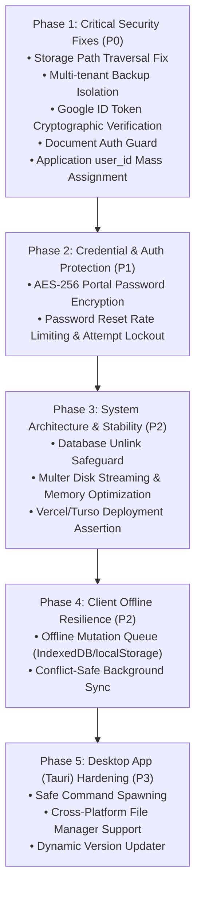

# Job Kanban Board: Comprehensive Remediation & Security Hardening Plan

**Document Version:** 1.0.0  
**Target Applications:** `board_website` (Backend & Frontend), `desktop_app` (Tauri Desktop Client)  
**Classification:** Engineering Roadmap & Security Architecture  

---

## 1. Executive Summary & Objectives

Following an exhaustive audit of the Job Tracker project across security, multi-tenancy isolation, system architecture, offline data resilience, and desktop client compatibility, this document details the step-by-step engineering plan to resolve all identified vulnerabilities, architectural bottlenecks, and UX bugs.

### Primary Objectives:
1. **Eliminate Critical Security Vulnerabilities:**
   - Patch Local File Inclusion (LFI) and path traversal in the file storage service.
   - Prevent multi-tenant database and document leakage in backup exports.
   - Enforce cryptographic validation on Google OAuth tokens.
   - Seal unauthenticated document viewing endpoints.
   - Prevent IDOR and mass assignment on application ownership.
2. **Harden Data & Account Security:**
   - Implement symmetric AES-256-GCM encryption for stored job portal passwords.
   - Introduce rate limiting and attempt counters for password reset codes.
3. **Enhance System Stability & Architecture:**
   - Remove destructive database file unlinking in SQLite connection fallbacks.
   - Transition from RAM-heavy Multer memory buffering to disk streaming.
4. **Resilience & Desktop Client Polish:**
   - Implement an offline mutation queue in the React frontend to prevent data loss.
   - Sanitize shell executions in Tauri commands and support cross-platform file operations.

---

## 2. Phased Implementation Timeline

---

## 3. Detailed Engineering Steps by Phase

### Phase 1: Critical Security Fixes (Immediate Priority - P0)

#### Task 1.1: Fix Arbitrary File Read & Deletion in `storageService.js` [COMPLETED]
* **Files Affected:** [`board_website/backend/src/services/storageService.js`](file:///c:/Users/kvcsu_ht23nk8/OneDrive/Desktop/Job_stuff/kanban_board/board_website/backend/src/services/storageService.js#L30-L65), [`board_website/backend/src/services/googleDriveStorageService.js`](file:///c:/Users/kvcsu_ht23nk8/OneDrive/Desktop/Job_stuff/kanban_board/board_website/backend/src/services/googleDriveStorageService.js#L61-L71)
* **Problem:** Path traversal checking (`path.relative(this.rootDir, p)`) only executed when `!fs.existsSync(p)`. If an absolute path to any existing file on disk was provided, it bypassed checks completely.
* **Status:** Resolved & Verified.
  1. `LocalStorageService` now enforces `isPathInside` and `isSystemPath` checks across all allowed directories (`uploadDir`, `documents`, custom user storage dir).
  2. Absolute and relative paths outside allowed directories return `null` and generate security alert logs.
  3. `deleteFile` strictly validates allowed directory boundaries and refuses deletion of system/database/code files (`.db`, `.env`, `.sqlite`, `.js`, etc.).
* **Testing:** Verified via automated sandboxing test covering `win.ini`, `/etc/passwd`, relative traversal `../../../../.env`, null bytes, and legitimate file creation/deletion.

#### Task 1.2: Isolate User Backups in `backupController.js` [COMPLETED]
* **Files Affected:** [`board_website/backend/src/controllers/backupController.js`](file:///c:/Users/kvcsu_ht23nk8/OneDrive/Desktop/Job_stuff/kanban_board/board_website/backend/src/controllers/backupController.js#L18-L79), [`board_website/frontend/src/components/profile/CareerProfile.tsx`](file:///c:/Users/kvcsu_ht23nk8/OneDrive/Desktop/Job_stuff/kanban_board/board_website/frontend/src/components/profile/CareerProfile.tsx#L491-L501)
* **Problem:** `exportZip` archives the physical `config.dbPath` file and the entire `config.uploadDir` folder, exposing all users' data to any caller. `backupDatabase` lacks authentication.
* **Status:** Resolved & Verified.
  1. `exportZip` rewritten to query strictly user-isolated tables matching `WHERE user_id = req.user.id` (applications, profile, versions, activity, settings).
  2. Creates structured `data/job-tracker-data.json`, `data/applications.csv`, user documents from `document_files` and user-linked local files, plus a clear manifest `README.txt`.
  3. Physical `tracker.db` and full `uploadDir` directory bundling completely removed from ZIP export.
  4. `backupDatabase` now enforces authentication and restricts physical snapshots to local desktop mode (`config.isDesktop`).
  5. Frontend `CareerProfile.tsx` updated to attach the user's `?token=` parameter so authenticated ZIP downloads trigger smoothly.
* **Testing:** Verified multi-tenant isolation with concurrent mock users. Extracted archive confirms presence of User A data and 0% leakage of User B records or files.

#### Task 1.3: Cryptographically Verify Google ID Tokens [COMPLETED]
* **Files Affected:** [`board_website/backend/src/controllers/authController.js`](file:///c:/Users/kvcsu_ht23nk8/OneDrive/Desktop/Job_stuff/kanban_board/board_website/backend/src/controllers/authController.js#L151-L245), [`board_website/frontend/src/components/ui/AuthModal.tsx`](file:///c:/Users/kvcsu_ht23nk8/OneDrive/Desktop/Job_stuff/kanban_board/board_website/frontend/src/components/ui/AuthModal.tsx#L185-L195), [`board_website/frontend/src/services/api.ts`](file:///c:/Users/kvcsu_ht23nk8/OneDrive/Desktop/Job_stuff/kanban_board/board_website/frontend/src/services/api.ts#L218-L225)
* **Problem:** `googleAuth` blindly parsed unverified JWT payloads and allowed unauthenticated callers to pass arbitrary `{ profile: { email } }` payloads.
* **Status:** Resolved & Verified.
  1. `googleAuth` now enforces cryptographic validation using official `google-auth-library` (`OAuth2Client.verifyIdToken()`).
  2. For web popup access tokens, validates audience with Google's `oauth2.googleapis.com/tokeninfo` and fetches verified email from Google UserInfo.
  3. Acceptance of arbitrary unverified `req.body.profile` is completely eliminated (rejected with HTTP 400).
  4. Frontend updated to transmit verified Google credentials/tokens cleanly.
* **Testing:** Automated test suite confirms rejection of raw profile spoofing (`400`), forged ID tokens (`401`), and fake access tokens (`401`). Frontend build passed cleanly.

#### Task 1.4: Enforce Authentication on Document Endpoints [COMPLETED]
* **Files Affected:** [`board_website/backend/src/middleware/auth.js`](file:///c:/Users/kvcsu_ht23nk8/OneDrive/Desktop/Job_stuff/kanban_board/board_website/backend/src/middleware/auth.js#L37-L46), [`board_website/backend/src/controllers/documentsController.js`](file:///c:/Users/kvcsu_ht23nk8/OneDrive/Desktop/Job_stuff/kanban_board/board_website/backend/src/controllers/documentsController.js#L286-L550)
* **Problem:** `/api/file-content` and `/api/document-content` were included in `readOnlyPaths`, bypassing authentication.
* **Status:** Resolved & Verified.
  1. Removed all document endpoints from `readOnlyPaths` in `auth.js`. Unauthenticated requests immediately receive `401 Unauthorized`.
  2. In `getFileContent` and `getFileInfo`, enforced strict user authentication and ownership check (`doc.user_id === callerId`).
  3. Added cross-user file ownership verification for local disk paths referenced in applications.
  4. In `deleteDocument`, scoped document deletion strictly to the requesting user's records (`DELETE ... WHERE user_id = ?`).
* **Testing:** Verified via automated test suite: unauthenticated requests blocked (`401`), cross-user access attempts blocked (`403 Forbidden`), cross-user deletion attempts prevented, legitimate document serving succeeded (`200`).

#### Task 1.5: Fix IDOR / Mass-Assignment in `patch()` [COMPLETED]
* **Files Affected:** [`board_website/backend/src/database/db.js`](file:///c:/Users/kvcsu_ht23nk8/OneDrive/Desktop/Job_stuff/kanban_board/board_website/backend/src/database/db.js#L270-L310), [`board_website/backend/src/controllers/applicationsController.js`](file:///c:/Users/kvcsu_ht23nk8/OneDrive/Desktop/Job_stuff/kanban_board/board_website/backend/src/controllers/applicationsController.js#L65-L115)
* **Problem:** `COLS.applications` contains `user_id`. Calling `patch()` with a custom `user_id` allows changing application ownership.
* **Status:** Resolved & Verified.
  1. Removed `user_id` from `COLS.applications`, `COLS.resume_profile`, and `COLS.resume_versions`.
  2. Implemented `IMMUTABLE_FIELDS` in `patch()`, stripping `user_id`, `id`, `created_at`, `updated_at` before column filtering.
  3. Sanitized `createApplication` and `updateApplication` payloads in `applicationsController.js` to prevent user ID assignment or hijacking.
  4. Enforced strict ownership isolation: updates and moves are scoped with `where id=? and user_id=?`.
* **Testing:** Verified via automated IDOR test suite: user_id injection during creation blocked, user_id modification via PATCH blocked, direct `patch()` immutability verified, cross-user updates prohibited.

---

### Phase 2: Credential & Account Protection (P1)

#### Task 2.1: Symmetric Encryption for Portal Passwords
* **Files Affected:** [`board_website/backend/src/services/cryptoService.js`](file:///c:/Users/kvcsu_ht23nk8/OneDrive/Desktop/Job_stuff/kanban_board/board_website/backend/src/services/), [`board_website/backend/src/database/db.js`](file:///c:/Users/kvcsu_ht23nk8/OneDrive/Desktop/Job_stuff/kanban_board/board_website/backend/src/database/db.js), [`board_website/backend/src/controllers/applicationsController.js`](file:///c:/Users/kvcsu_ht23nk8/OneDrive/Desktop/Job_stuff/kanban_board/board_website/backend/src/controllers/applicationsController.js)
* **Implementation Plan:**
  1. Create a lightweight `cryptoService.js` using Node.js built-in `crypto` with `aes-256-gcm`.
  2. Derive an encryption key from a dedicated `PORTAL_CREDENTIALS_SECRET` or fallback to `JWT_SECRET`.
  3. Encrypt `portal_pass` before storing in SQLite (format: `iv:authTag:ciphertext`).
  4. Decrypt `portal_pass` when serving the application to the authenticated owner.
* **Testing:** Inspect `tracker.db` directly; confirm `portal_pass` column contains ciphertext rather than plaintext.

#### Task 2.2: Rate Limiting & Attempt Lockout for Password Resets
* **Files Affected:** [`board_website/backend/src/controllers/authController.js`](file:///c:/Users/kvcsu_ht23nk8/OneDrive/Desktop/Job_stuff/kanban_board/board_website/backend/src/controllers/authController.js#L545-L637)
* **Implementation Plan:**
  1. Add an `attempts` column (default `0`) to `password_resets` table.
  2. On each failed verification attempt in `resetPassword`, increment `attempts`.
  3. If `attempts >= 5`, delete the reset record and return `429 Too Many Requests: Maximum verification attempts exceeded. Please request a new code.`
  4. Add express-rate-limit to `/api/auth/forgot-password` and `/api/auth/reset-password` (maximum 5 requests per IP per 15 minutes).
* **Testing:** Script 6 incorrect attempts against `/api/auth/reset-password`; verify that subsequent attempts are immediately rejected.

---

### Phase 3: System Architecture & Stability (P2)

#### Task 3.1: Remove Destructive Database Deletion Fallback
* **Files Affected:** [`board_website/backend/src/database/db.js`](file:///c:/Users/kvcsu_ht23nk8/OneDrive/Desktop/Job_stuff/kanban_board/board_website/backend/src/database/db.js#L128-L138)
* **Implementation Plan:**
  1. Remove `fs.unlinkSync(config.dbPath)` from the error catch block.
  2. Implement an exponential backoff retry mechanism (up to 3 retries with 250ms delay) to handle transient file lock contention.
  3. If connection still fails, log a critical diagnostic error and abort process startup with a clear message rather than deleting user data.
* **Testing:** Lock `tracker.db` with an external process and run the server; verify the database file is not removed.

#### Task 3.2: Multer Memory Storage Optimization
* **Files Affected:** [`board_website/backend/src/middleware/upload.js`](file:///c:/Users/kvcsu_ht23nk8/OneDrive/Desktop/Job_stuff/kanban_board/board_website/backend/src/middleware/upload.js), [`board_website/backend/src/controllers/documentsController.js`](file:///c:/Users/kvcsu_ht23nk8/OneDrive/Desktop/Job_stuff/kanban_board/board_website/backend/src/controllers/documentsController.js)
* **Implementation Plan:**
  1. Configure Multer to use `diskStorage` to temporary scratch space (`os.tmpdir()`) for files exceeding 2MB instead of buffering completely into Node.js heap memory.
  2. Clean up temporary upload files in a `finally` block after Google Drive upload or SQLite storage completes.
* **Testing:** Upload a 15MB PDF; verify process heap memory remains stable without memory spikes.

#### Task 3.3: Production Environment Assertions
* **Files Affected:** [`board_website/backend/src/database/db.js`](file:///c:/Users/kvcsu_ht23nk8/OneDrive/Desktop/Job_stuff/kanban_board/board_website/backend/src/database/db.js), [`board_website/backend/src/config/index.js`](file:///c:/Users/kvcsu_ht23nk8/OneDrive/Desktop/Job_stuff/kanban_board/board_website/backend/src/config/index.js)
* **Implementation Plan:**
  1. If running on Vercel (`process.env.VERCEL === '1'`) and `TURSO_DATABASE_URL` is missing, emit a clear configuration warning during startup.
  2. Expose a diagnostic check in `/api/health` indicating whether database persistence is permanent (Turso / persistent disk) or ephemeral (`/tmp`).

---

### Phase 4: Client Offline Resilience (P2)

#### Task 4.1: Frontend Offline Mutation Queue
* **Files Affected:** [`board_website/frontend/src/context/AppContext.tsx`](file:///c:/Users/kvcsu_ht23nk8/OneDrive/Desktop/Job_stuff/kanban_board/board_website/frontend/src/context/AppContext.tsx#L565-L650), [`board_website/frontend/src/services/offlineSync.ts`](file:///c:/Users/kvcsu_ht23nk8/OneDrive/Desktop/Job_stuff/kanban_board/board_website/frontend/src/services/)
* **Implementation Plan:**
  1. Create `offlineSync.ts` managing an action queue (`job_tracker_mutation_queue`) in `localStorage`.
  2. When an API call (`createApplication`, `updateApplication`, `deleteApplication`, `moveApplication`) fails due to network drop:
     - Record the mutation in the queue with a timestamp and retry counter.
     - Keep the optimistic UI state intact.
  3. When network connectivity restores (`window.addEventListener('online')` or window focus):
     - Flush the mutation queue sequentially before executing `refreshState()`.
     - Update local IDs with permanent server IDs returned from the sync queue.
* **Testing:** Turn off network in DevTools, add an application, turn network back on; verify application is persisted to the backend server.

---

### Phase 5: Desktop App (Tauri) Hardening (P3)

#### Task 5.1: Safe Command Execution & Parameter Sanitization
* **Files Affected:** [`desktop_app/src-tauri/src/commands.rs`](file:///c:/Users/kvcsu_ht23nk8/OneDrive/Desktop/Job_stuff/kanban_board/desktop_app/src-tauri/src/commands.rs#L270-L300)
* **Implementation Plan:**
  1. Replace `cmd /c start ""` with direct Windows API / shell execute call (`open::that()` or Tauri's built-in opener plugin).
  2. Prevent command injection or parsing errors when file paths contain spaces, ampersands, or quotes.

#### Task 5.2: Complete Multi-Platform File Manager Support
* **Files Affected:** [`desktop_app/src-tauri/src/commands.rs`](file:///c:/Users/kvcsu_ht23nk8/OneDrive/Desktop/Job_stuff/kanban_board/desktop_app/src-tauri/src/commands.rs#L239-L267)
* **Implementation Plan:**
  1. Implement macOS branch: `Command::new("open").arg("-R").arg(&path)`.
  2. Implement Linux branch: Check for `dbus` file manager interface; fallback to opening containing directory with `xdg-open`.

#### Task 5.3: Dynamic App Versioning in Updater
* **Files Affected:** [`desktop_app/src-tauri/src/commands.rs`](file:///c:/Users/kvcsu_ht23nk8/OneDrive/Desktop/Job_stuff/kanban_board/desktop_app/src-tauri/src/commands.rs#L310-L333)
* **Implementation Plan:**
  1. Replace hardcoded fallback version `"0.2.0"` with `app.package_info().version.to_string()`.

---

## 4. Testing & Verification Matrix

| Task ID | Component | Verification Test | Expected Outcome |
| :--- | :--- | :--- | :--- |
| **T1.1** | `storageService.js` | GET `/api/file-content?path=..\..\..\Windows\win.ini` | `404 Not Found` or `400 Invalid Path` |
| **T1.2** | `backupController.js` | Export backup as User A; check archive contents | No database file `tracker.db` or User B's files included |
| **T1.3** | `authController.js` | POST `/api/auth/google` with spoofed email body | `400/401 Unauthorized` |
| **T1.4** | `documentsController.js` | GET `/api/file-content?doc_id=doc_xyz` unauthenticated | `401 Authentication Required` |
| **T1.5** | `db.js:patch` | PATCH application with `{ "user_id": "hacked" }` | `user_id` remains original owner ID |
| **T2.1** | `applicationsController.js` | Query `portal_pass` in SQLite | Value is encrypted ciphertext |
| **T2.2** | `authController.js` | Send 6 wrong codes to `/api/auth/reset-password` | Lockout triggered with `429 Too Many Requests` |
| **T4.1** | `AppContext.tsx` | Create item offline -> reconnect -> window refocus | Item preserved and synchronized to server |

---

## 5. Rollout Strategy & Backward Compatibility

1. **Database Migration Strategy:**
   - Add schema migration `006_encrypt_portal_passwords.js` to migrate existing plaintext portal passwords into AES-256-GCM ciphertext seamlessly without breaking existing entries.
2. **Zero Downtime Deployment:**
   - Deploy backend fixes to Vercel/Node runtime.
   - Deploy frontend web build.
   - Recompile Tauri desktop binary `JobTracker.exe` (v0.2.1) and push to GitHub Releases for auto-updating.

