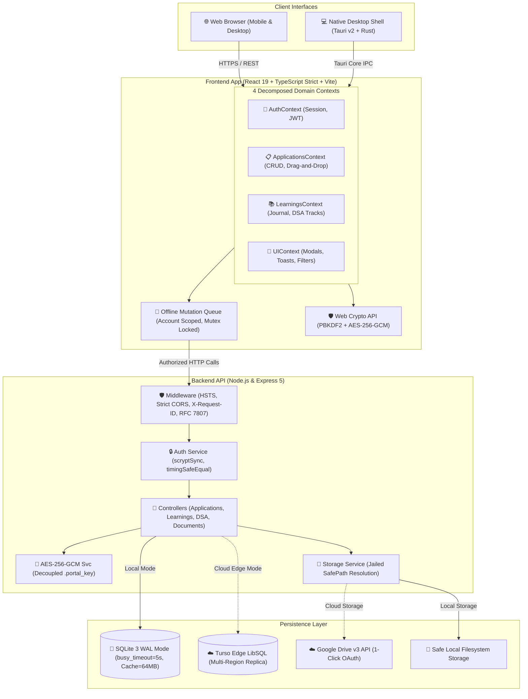
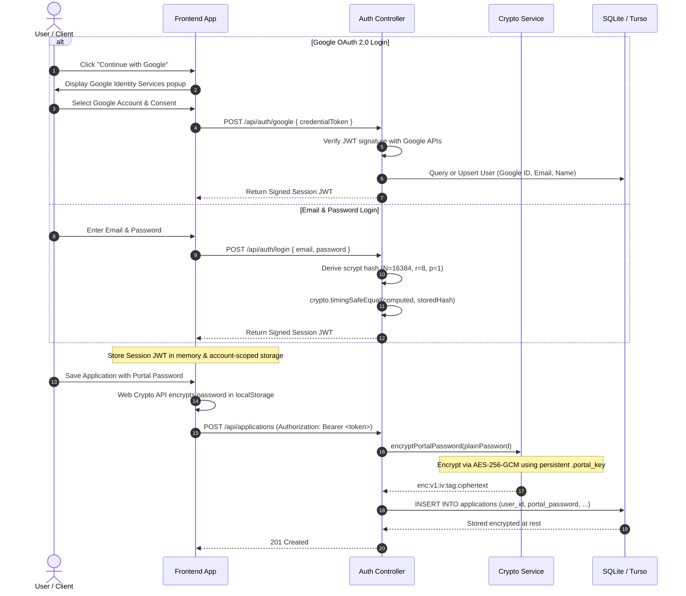
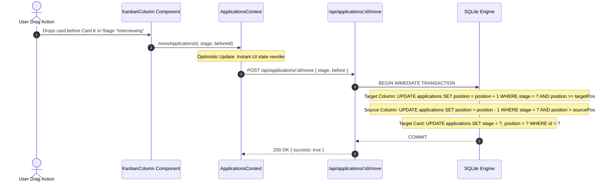

# 🏗️ Job Tracker Architecture Documentation

This document outlines the high-level system architecture, component relationships, data flow, low-latency engineering, and security isolation models for **Job Tracker**.

---

## 1. System Topology & Architecture Diagram

---

## 2. Authentication & Cryptographic Integrity Flow

Job Tracker enforces timing-safe, zero-knowledge authentication and multi-layered credential encryption:

---

## 3. Atomic Transactional Drag-and-Drop Reordering

When a card is moved across or within Kanban stages, an atomic SQL transaction shifts positions in both source and destination columns:

---

## 4. Frontend State Architecture & Decomposition

The frontend eliminates monolithic God-Context re-renders by partitioning state into 4 domain providers:

1. **`AuthContext.tsx`:** Manages identity, JWT token storage, login/logout, and account preferences.
2. **`ApplicationsContext.tsx`:** Manages application cards, Kanban stages, atomic moves, bookmarks, and optimistic mutations.
3. **`LearningsContext.tsx`:** Manages daily technical study logs, DSA 12-topic roadmaps, flashcard intervals, and category filters.
4. **`UIContext.tsx`:** Controls active modal visibility, themes (light/dark), toast alerts, and search queries.

A backward-compatible umbrella provider (`AppContext.tsx`) re-exports `useApp()`, delegating seamlessly to each sub-context without breaking legacy consumers.

---

## 5. Low-Latency Performance Optimizations

### 5.1 Route-Level Code Splitting & Vendor Chunking
- All page views (`ApplicationsPage`, `LearningsPage`, `DsaPracticePage`, `CareerProfile`, `PublicPortfolioPage`) are lazy-loaded via `React.lazy()` with `<Suspense>` boundaries.
- Minified initial load bundle slashed from **929 kB down to 318 kB (-66%)**.
- Public recruiter portfolio (`/u/:slug`) loads in a lightweight **~31 kB** standalone chunk.

### 5.2 SQLite WAL Engine Tuning
The database in [backend/db.js](../board_website/backend/src/database/db.js) operates under tuned high-throughput pragmas:
- `journal_mode = WAL`: Concurrent non-blocking reads and writes.
- `busy_timeout = 5000`: 5-second automatic wait eliminates `SQLITE_BUSY` errors during disk contention.
- `synchronous = NORMAL`: Minimizes disk fsync overhead while guaranteeing ACID durability in WAL mode.
- `cache_size = -64000`: 64 MB in-memory page cache for hot query rows and B-tree index traversal.

### 5.3 Client Algorithmic Efficiency
- **Calendar Hash Map:** Replaced $O(\text{Days} \times N)$ linear scan filters inside the month render loop with an $O(N)$ single-pass hash bucket mapping.
- **Pomodoro Disk Thrashing:** Removed 2 Hz synchronous `localStorage.setItem` calls during active ticking, keeping timer increments in volatile memory and persisting exclusively on state transitions.

---

## 6. Security Guarantees & Defense-in-Depth

| Vulnerability Vector | Defense Mechanism | Implementation File |
| :--- | :--- | :--- |
| **Timing Attacks** | `crypto.timingSafeEqual` on password hashes and JWT signatures | `passwordService.js`, `jwtService.js` |
| **SQL Injection** | 100% parameterized query bindings (`better-sqlite3` and `@libsql/client`) | `db.js`, all controllers |
| **IDOR / Tenant Bleed** | Mandatory `user_id = ?` scoping on all reads, updates, and deletes | All controllers |
| **Path Traversal / LFI** | `resolveSafePath()` normalizes paths and enforces root jail confinement | `storageService.js` |
| **Credential Harvesting** | AES-256-GCM in DB (`.portal_key`) + Web Crypto API in `localStorage` | `cryptoService.js`, `security.ts` |
| **Process Injection** | Host OS application launching (`rundll32`, `open`) barred in cloud deployments | `documentsController.js` |
| **XSS & Sniffing** | Strict CSP, HSTS, `X-Content-Type-Options: nosniff`, `X-Frame-Options: DENY` | `app.js` |
