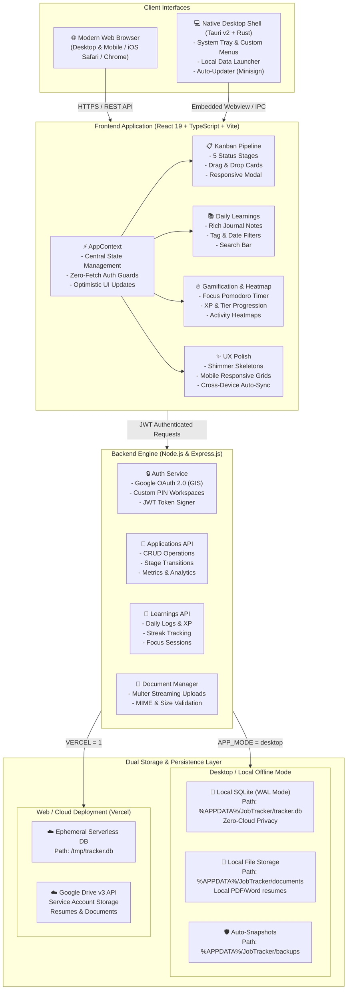
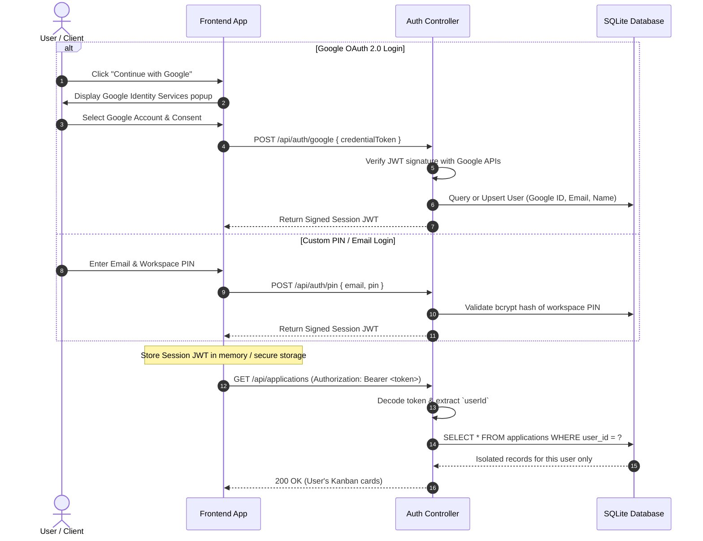
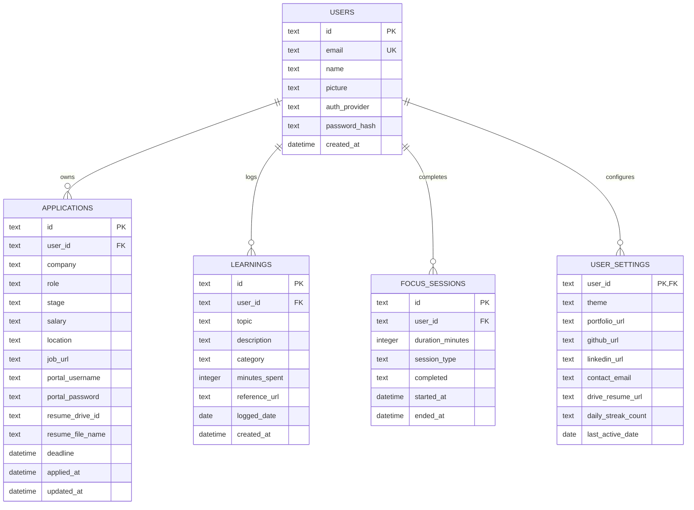

# 🏗️ Job Tracker Architecture Documentation

This document outlines the high-level system architecture, component relationships, data flow, and security isolation models for **Job Tracker**.

---

## 1. System Topology & Architecture Diagram

---

## 2. Authentication & Multi-User Data Isolation Flow

Job Tracker enforces strict per-user data isolation. Unauthenticated or logged-out users are protected by **Zero-Fetch Guards** that stop network calls from exposing cached metrics.

---

## 3. Desktop Application Architecture (Tauri v2 + Rust)

The desktop application is built with **Tauri v2** to deliver native desktop capabilities without Electron's heavy resource footprint:

- **Binary Size**: ~3.5 MB installer (vs. 150MB+ in typical Electron apps).
- **Embedded Webview**: Utilizes Microsoft Edge WebView2 on Windows.
- **Single-Executable Launcher**: `app.exe` natively embeds the compiled frontend bundle and bridges to local system APIs via Rust IPC.
- **Background Engine Manager**: [`start-desktop.bat`](file:///c:/Users/kvcsu_ht23nk8/OneDrive/Desktop/Job_stuff/kanban_board/start-desktop.bat) verifies if the background SQLite engine is running on `127.0.0.1:3000`. If offline, it starts it silently in the background with `APP_MODE=desktop`.
- **System Tray**:
  - Left-click icon toggles visibility.
  - Right-click menu provides quick access to *Show Window*, *Open Data Folder*, *Open Logs*, and *Quit*.
  - Closing the application window minimizes to the tray instead of terminating background sync.

---

## 4. Database Schema Overview

The SQLite database operates in **Write-Ahead Logging (WAL)** mode for concurrent read/write transactions:

---

## 5. Security & Privacy Guarantees

1. **Zero-Fetch Logged-Out Guard**: When no valid JWT session exists, the frontend displays neutral empty states and executes zero authenticated endpoints.
2. **Strict SQL Parameterization**: Every database query uses parameterized statements (`?`), mitigating SQL injection risks.
3. **Local Storage First (Desktop)**: In desktop mode, all personal job applications, compensation details, credentials, and uploaded resumes remain stored locally on the user's hard drive at `%APPDATA%\JobTracker\`.
4. **Cloud Privacy (Web)**: In cloud mode, credentials and documents are stored only within user-authorized Google Drive folders using encrypted tokens.
